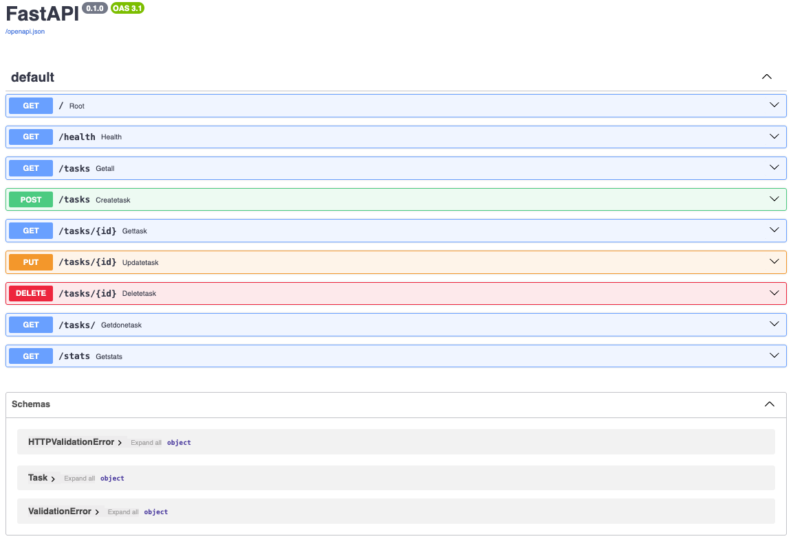
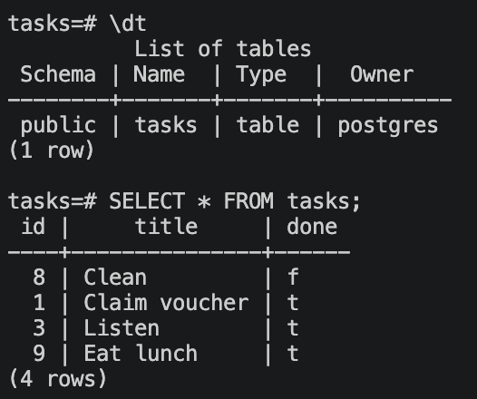

# FLYRANK: CRUD API

A REST API for managing a to-do list, built with FastAPI. The project started as an in-memory CRUD implementation and progressively introduced SQLite, PostgreSQL, Docker, environment-based configuration, and a layered architecture.

## Tech Stack

* Python 3.11
* FastAPI
* Psycopg
* PostgreSQL
* Docker
* uv

## Current Features

* CRUD operations for tasks
* Task filtering and statistics
* PostgreSQL persistence
* Dockerized API and database
* Environment-based database configuration
* Interactive API documentation with Swagger UI
* Repository and service layers

## Progression

1. **In-memory CRUD API**
2. **SQLite persistence**
3. **PostgreSQL with Docker**
4. **Gradual architectural refactoring**

## Getting Started

### Prerequisites

* Docker

### Setup

Clone the repository:

```bash
git clone https://github.com/Limkurt/flyrank-backend-assignment.git
cd flyrank-backend-assignment
```

Create `.env` from `.env.example` and configure the database variables.

Start the application:

```bash
docker compose up
```

Docker Compose builds the API image, installs the Python dependencies, and starts the PostgreSQL database.

The API will be available at:

* http://0.0.0.0:8000
* Swagger UI: http://0.0.0.0:8000/docs

## API Endpoints

| Method | Endpoint      | Description              |
| ------ | ------------- | ------------------------ |
| GET    | `/`           | Home                     |
| GET    | `/health`     | API health check         |
| GET    | `/tasks`      | Retrieve all tasks       |
| GET    | `/tasks/{id}` | Retrieve a task          |
| GET    | `/tasks/`     | Retrieve tasks by status |
| GET    | `/stats`      | Task statistics          |
| POST   | `/tasks`      | Create a task            |
| PUT    | `/tasks/{id}` | Update a task            |
| DELETE | `/tasks/{id}` | Delete a task            |

## Example

```bash
curl -X POST http://0.0.0.0:8000/tasks \
  -H "Content-Type: application/json" \
  -d '{"title":"Buy milk"}'
```

```json
{
  "id": 4,
  "title": "Buy milk",
  "done": false
}
```

## Swagger UI



## Database



## AI vs Me

### 1. What did the AI do better?
It used schemas and OOP principles, which ensured consistency between request and response payloads. It also generated better Swagger documentation by organizing endpoints and providing example request bodies, making it more user-friendly and clearer on how the program functions and how to use it. Moreover, it had a better project structure; even though I gave it my desired layout, it improved on it by consolidating everything into a single app directory. Overall, the AI-generated implementation was cleaner, although it did not abstract HTTPException into a reusable helper function to cut down on repetitive typing. However, the AI version did make better use of classes for catching and raising errors.

### 2. What did it get wrong or quietly ignore?
It hardcoded the secret and didn't use psycopg, opting for sqlalchemy instead. It also hardcoded the GET /health API without checking if the database is actually running with SELECT 1 FROM taskdb.

### 3. What did my prompt forget to specify?
I forgot to mention which package manager to use, which module to use to interact with the database, and the database name itself. I also forgot to specify how to properly output the result, such as whether it should be in a downloadable file format or just a simple, copyable code block.


## Limitations

* No authentication or authorization yet.